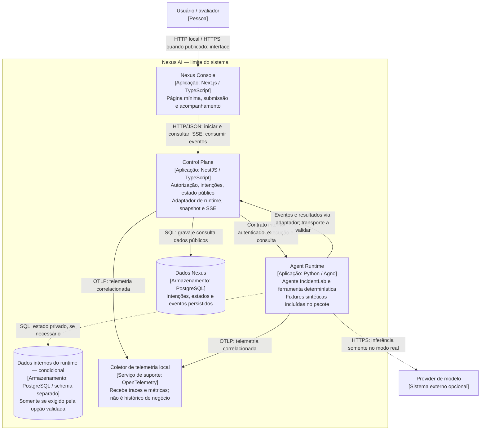

# C4 — Containers do Nexus AI (nível 2)

Arquitetura proposta · Fase 01 · 8 de novembro de 2026 · [ADR-000](../adr/000-product-architecture-principles.md) · [Contexto](c4-context.md)

Container significa unidade executável ou armazenamento no modelo C4, não necessariamente um container Docker. São três aplicações, acompanhadas de persistência e suporte de observabilidade. O diagrama usa Mermaid com tipos e tecnologias explícitos.

## Leitura e limites

- As setas descrevem dependências ou fluxos indicados pelos rótulos. A resposta SSE parte do Control Plane para o Console pela conexão aberta pelo cliente; nenhum stream público vem diretamente do runtime.
- Um cliente HTTP de teste pode substituir o Console e acessar a mesma API pública, com a mesma autorização.
- Dados Nexus pertencem ao Control Plane. Dados privados do runtime são condicionais ao spike e podem usar a mesma instância física PostgreSQL, com schema e usuário separados.
- O transporte interno está pendente: eventos podem ser consumidos pelo adaptador ou recebidos em endpoint interno autenticado. O diagrama não impõe callback nem conexão direta ao banco Nexus pelo runtime.
- O agendamento tem um único dono, a escolher pelo spike. Dispatcher/reconciliador são responsabilidades internas, não serviços adicionais aprovados por este diagrama. Se necessário, um worker Nexus invocará Agno como biblioteca; uma decisão posterior atualizará esta vista.
- Na fase, ferramenta e fixtures são locais ao pacote IncidentLab. Uma API independente de simulação é evolução, sem exigência de um quarto serviço de aplicação agora.
- Linhas pontilhadas indicam dependências condicionais. Não há Redis, fila externa, banco vetorial ou cloud obrigatórios. Queda da telemetria não impede execução.
- Credenciais de provider ficam no runtime; navegador não acessa bancos ou serviços internos. Autenticação interna e contexto autorizado são exigidos, com mecanismo a detalhar em ADR específico.

## Mapeamento para o repositório

| Elemento | Local |
|---|---|
| Console | `apps/web/` |
| Control Plane e adaptador | `apps/api/` |
| Bootstrap AgentOS | `apps/agent-runtime/` |
| Agentes reutilizáveis e IncidentLab | `python/nexus-agents/` e `python/incidentlab/` |
| Contratos e cliente | `packages/contracts/` e `packages/sdk-typescript/` |
| PostgreSQL local e observabilidade | `infra/docker/`, `infra/observability/` e Compose da raiz |

Pacotes são dependências de código, não containers C4. A mock API tem local reservado em `services/incidentlab-mock-api/` para quando for necessária. [ADR-001](../adr/001-agent-runtime.md), [ADR-002](../adr/002-contracts-and-api.md) e [ADR-003](../adr/003-persistence.md) detalham as decisões e seus gates.
