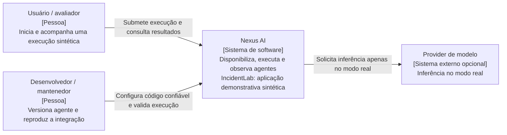

# C4 — Contexto do Nexus AI (nível 1)

Arquitetura proposta · Fase 01 · 8 de novembro de 2026 · [ADR-000](../adr/000-product-architecture-principles.md)

O limite do sistema inclui o Console, o Control Plane, o runtime e os dados sintéticos do IncidentLab. Este é um diagrama C4 expresso em Mermaid; os rótulos identificam pessoas e sistemas, sem detalhar implementação.

A demo determinística não depende do provider. O desenvolvedor entrega código pelo repositório e build local, não por upload na UI. Não há integração com infraestrutura real de incidentes, provedor corporativo de identidade ou marketplace nesta fase. Telemetria local integra o ambiente do Nexus e aparece na vista de containers.
